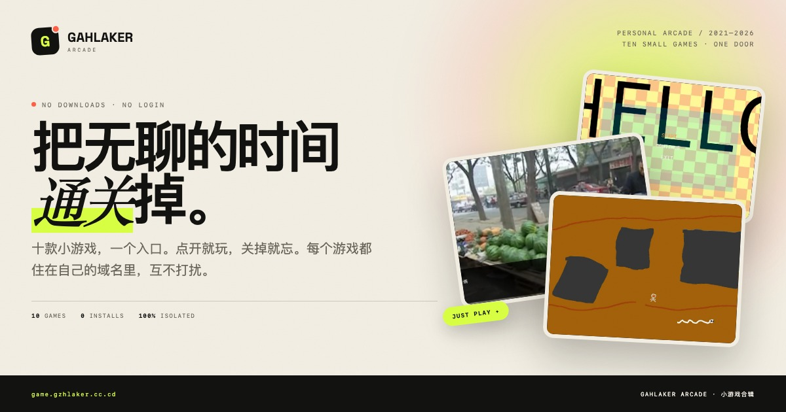
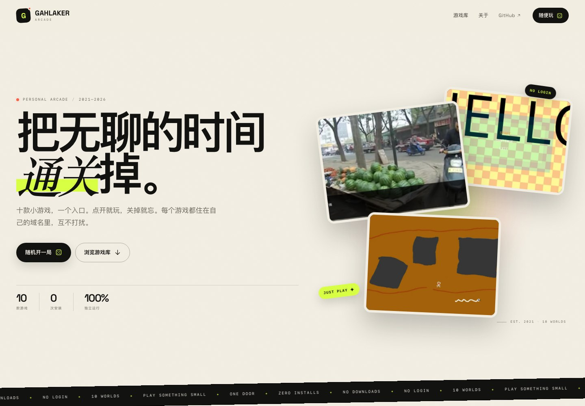
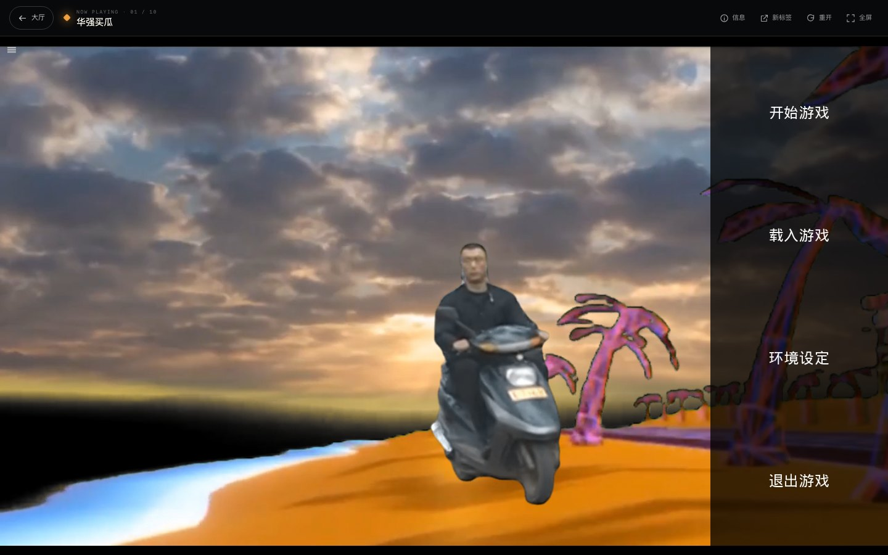
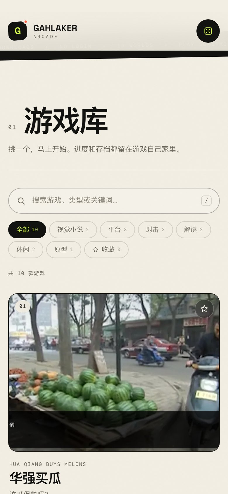

# Gahlaker Arcade

> 十款小游戏，一个入口。点开就玩，关掉就忘。



一个人的小游戏合辑。纯静态页面，最终部署在 **Cloudflare Pages**。

## 预览





- **线上地址（GitHub Actions 部署完成后）**：<https://game.gzhlaker.cc.cd/>（Cloudflare Pages 自定义域名）
- **Pages 项目域名（部署后可用）**：<https://gzhlaker-arcade.pages.dev>
- **源码**：<https://github.com/guozihang/gahlaker-game>

## 它是什么

一个游戏大厅：所有小游戏集中在同一页，按类型筛选、搜索、收藏、随机开一局。每个游戏都运行在自己的子域名里，通过 iframe 嵌入。打开游戏时挂载一个 iframe，返回大厅时整个浏览上下文被销毁——脚本、计时器、音频、存档都留在它自己的域名里，互不打扰。

游戏本体不在这个仓库里，它们分别是：

| # | 游戏 | 类型 | 地址 |
|---|------|------|------|
| 01 | 华强买瓜 | 视觉小说 / 玩梗 | <https://huaqiang.gzhlaker.cc.cd/> |
| 02 | 找出病毒 | 休闲 / 解谜 / 像素 | <https://escape.gzhlaker.cc.cd/> |
| 03 | Qubic Advance | 平台 / 解谜 / 3D | <https://qubic.gzhlaker.cc.cd/> |
| 04 | I Wanna Be The Caina | 平台 / 硬核 / 像素 | <https://iwanna.gzhlaker.cc.cd/> |
| 05 | Forest Advance | 平台 / 冒险 / 手绘 | <https://game-d.gzhlaker.cc.cd/> |
| 06 | Contra | 射击 / 弹幕 / 街机 | <https://contra.gzhlaker.cc.cd/> |
| 07 | G'clip | 视觉小说 / 鬼畜 / 脑洞 | <https://gclip.gzhlaker.cc.cd/> |
| 08 | Go Out | 休闲 / 手绘 / 猫咪 | <https://goout.gzhlaker.cc.cd/> |
| 09 | Juesey Club | 射击 / 弹幕 / 高难度 | <https://jusery.gzhlaker.cc.cd/> |
| 10 | Project 20200506 | 原型 / 射击 / 实验 | <https://game-f.gzhlaker.cc.cd/> |

## 功能

- 游戏库：搜索、按类型筛选、收藏、随机开一局
- 最近玩过：本地记录，卡片上会显示一个小圆点
- 即点即玩：进入播放器后自动加载，带加载动画和操作提示
- 播放器：返回大厅、重新开始、全屏、在新标签页打开、游戏信息
- 每个游戏独立 iframe；同一时间只挂载一个，退出即销毁
- 响应式布局；手机上有键盘/横屏提示
- 深色/浅色两套视觉（大厅纸感 + 播放器暗色）
- 无框架、无构建步骤（部署用 Wrangler），静态文件直接托管

## 本地运行

不需要安装依赖：

```bash
python3 -m http.server 8080
# 或者
npm run dev
```

打开 <http://localhost:8080/>。

必须通过 HTTP 访问，不要直接双击 `index.html`——ES Module 和跨域 iframe 在 `file://` 下会受限。

## 目录

```text
.
├── index.html                 # 大厅 + 播放器 + 信息弹窗
├── assets/
│   ├── css/
│   │   ├── base.css           # 变量、reset、字体
│   │   └── site.css           # 大厅、播放器、动效、响应式
│   ├── js/
│   │   ├── games.js           # ★ 游戏清单，加游戏改这里
│   │   └── app.js             # 筛选、搜索、收藏、路由、iframe 生命周期
│   ├── covers/                # 800×600 WebP 封面
│   ├── fonts/                 # 自托管 Space Grotesk + OFL 许可
│   ├── favicon.svg
│   ├── apple-touch-icon.png
│   └── og.jpg                 # 社交分享图
├── _headers                   # Cloudflare Pages 响应头 / CSP / 缓存
├── 404.html
├── robots.txt
├── sitemap.xml
├── wrangler.toml
├── package.json
└── .github/workflows/deploy-cloudflare.yml
```

## 添加一款游戏

1. 把封面放到 `assets/covers/<id>.webp`，建议 800×600，WebP。
2. 打开 `assets/js/games.js`，复制一个对象：

```js
{
  id: 'my-game',                    // 唯一；路由 #/game/my-game
  title: 'My Game',
  subtitle: '一句话副标题',
  url: 'https://my-game.gzhlaker.cc.cd/', // 独立子域名最稳
  cover: 'assets/covers/my-game.webp',
  accent: '#ff5f45',                // 播放器标题旁的小方块颜色
  tags: ['平台', '像素'],            // 至少一个 FILTERS 里的类型
  blurb: '卡片上的一句话。',
  description: '信息弹窗里的完整介绍。',
  controls: '方向键移动，空格跳跃',
  device: '键盘',                    // 键盘 / 鼠标 / 键鼠 / 触屏
  status: 'playable',               // 'playable' | 'prototype'
}
```

3. 如果 `tags` 里出现了新的类型，把它加进同文件的 `FILTERS`。
4. 如果游戏在新域名，更新 `_headers` 里的 `frame-src`：

```text
frame-src 'self' https://*.gzhlaker.cc.cd https://your-new-domain.example;
```

5. 刷新页面，`#/game/<id>` 就可以直接访问了。

### 本地游戏 / 同源游戏

游戏也可以放在 `games/<id>/index.html`，把 `url` 写成 `games/<id>/index.html`。但同源 iframe 会共享 `localStorage` 和 Cookie，隔离性不如独立子域名。更推荐给每个游戏一个 Cloudflare Pages 项目 + 子域名（就像现在这样）。

不建议给 iframe 加 `sandbox`：很多游戏引擎（Ren'Py、GameMaker、Construct）依赖同源存储、IndexedDB、指针锁和全屏权限，加上 sandbox 会破坏存档或直接白屏。这里的游戏都是作者自己的内容，按“可信内容 + 跨域隔离”处理。

## 隔离是怎么做的

- **跨域 iframe**：每个游戏在自己的子域名下，天然拥有独立的 JS 上下文、CSS、Cookie、localStorage、IndexedDB。
- **一次只开一个**：进入新游戏前先销毁旧 iframe；返回大厅时设置 `src="about:blank"` 并 `remove()`，浏览上下文被销毁，计时器/音频/RAF 全部停止。
- **父页面不碰游戏状态**：不读写游戏存档，不注入脚本，不共享全局变量。
- **父页面只存两件事**：收藏（`gahlaker-arcade:favorites:v1`）和最近玩过（`gahlaker-arcade:recent:v1`），都在浏览器本地。
- **路由**：`#/game/<id>` 可直接分享/刷新；浏览器后退会回到大厅。
- **弹窗提示**：打开“信息”时游戏仍在后台运行（跨域无法真正暂停），弹窗里已注明。

## 部署到 Cloudflare Pages

站点是纯静态文件，构建产物是 `dist/`。推荐用仓库里的 GitHub Actions 部署，不依赖本地 Wrangler 登录。

### 方式 A：GitHub Actions（推荐）

#### 1. 创建 Cloudflare API Token

Cloudflare Dashboard → 右上角头像 → **My Profile → API Tokens → Create Token**，使用自定义模板，权限至少：

- **Account → Cloudflare Pages → Edit**
- **Account → Account Settings → Read**（可选，方便确认账户）
- **Zone → DNS → Edit**（想让我在 workflow 里自动绑定 `game.gzhlaker.cc.cd` 时需要）

Account Resources 选择你的账户；Zone Resources 选择 `gzhlaker.cc.cd`（如果给了 DNS 权限）。

#### 2. 添加 GitHub Actions Secrets

GitHub 仓库 → **Settings → Secrets and variables → Actions → New repository secret**：

- `CLOUDFLARE_API_TOKEN`：上一步创建的 token
- `CLOUDFLARE_ACCOUNT_ID`：Cloudflare Dashboard 右侧 / Workers & Pages 概览里可以找到

#### 3. 运行 workflow

仓库 → **Actions → Deploy to Cloudflare Pages → Run workflow**。

workflow 会：

1. `npm ci`
2. `npm run build`
3. 尝试创建 `gzhlaker-arcade` Pages 项目（已存在则忽略）
4. `wrangler pages deploy dist --project-name=gzhlaker-arcade --branch=main`
5. 尝试把 `game.gzhlaker.cc.cd` 绑定为自定义域名

如果 secrets 还没配，workflow 会显示一条 notice 并跳过部署，不会报红。

> 如果 GitHub OAuth token 没有 `workflow` 权限，无法直接推送 `.github/workflows/` 文件。可以在本地终端执行 `gh auth refresh -s workflow` 后重新推送，或者把 `docs/deploy-cloudflare.yml` 的内容复制到 GitHub 网页端的 `.github/workflows/deploy-cloudflare.yml`。

#### 4. 自定义域名

Workflow 会尽力调用 Pages API 添加 `game.gzhlaker.cc.cd`。如果它在 Cloudflare 侧显示 pending，去：

**Workers & Pages → gzhlaker-arcade → Custom domains → Set up a custom domain**

添加 `game.gzhlaker.cc.cd`。DNS 在同一账户时 Cloudflare 会自动建 CNAME；手动建也可以：

```text
类型: CNAME
名称: game
目标: gzhlaker-arcade.pages.dev
代理: 已代理（橙色云）
```

### 方式 B：本地 Wrangler

```bash
npm install
npx wrangler login
npx wrangler pages project create gzhlaker-arcade --production-branch=main
npm run deploy
```

`npm run deploy` = `npm run build` + `wrangler pages deploy dist --project-name=gzhlaker-arcade`。

### 后续更新

Secrets 配好后，推到 `main` 会自动触发 workflow（只监听站点文件变化）；也可以在 Actions 页面手动运行。本地部署则执行 `npm run deploy`。

## 配置备忘

- **项目名**：`wrangler.toml` 和 `package.json` 里都是 `gzhlaker-arcade`
- **CSP**：`_headers` 的 `frame-src` 决定哪些域名可以被嵌入；加新游戏域名时记得改
- **缓存**：`/assets/*` 缓存 1 天；HTML 不缓存，方便更新
- **安全头**：`frame-ancestors 'none'` 防止本站被别的站点嵌套
- **OG/域名**：`index.html` 的 `og:image`、`canonical`，`robots.txt`，`sitemap.xml`

## 已知限制

- **手机 + 键盘游戏**：Qubic、Contra、I Wanna 等依赖键盘；手机上会看到提示，但体验有限。建议桌面或横屏 + 全屏。
- **跨域游戏无法被父页面暂停/读分**：播放器的“重开”是重新加载 iframe；“信息”弹窗不会暂停游戏。
- **游戏自身的加载画面**：Ren'Py / Construct / GameMaker 会先显示自己的 loading / splash，这是游戏自己的画面。
- **Safari 的第三方存储策略**：跨域 iframe 里的 localStorage 可能被分区或清理；存档行为以各游戏为准。
- **原型**：`Project 20200506` 是早期原型，`Juesey Club` 的完成度也以游戏内为准。
- **部分游戏可能需要鼠标/键盘**：卡片底部和加载页会标注操作方式。

## 许可

- 站点代码：作者保留所有权利。
- 游戏：版权归各自作者所有。
- 字体：[Space Grotesk](https://github.com/floriankarsten/space-grotesk)，SIL Open Font License 1.1，见 `assets/fonts/OFL.txt`。
